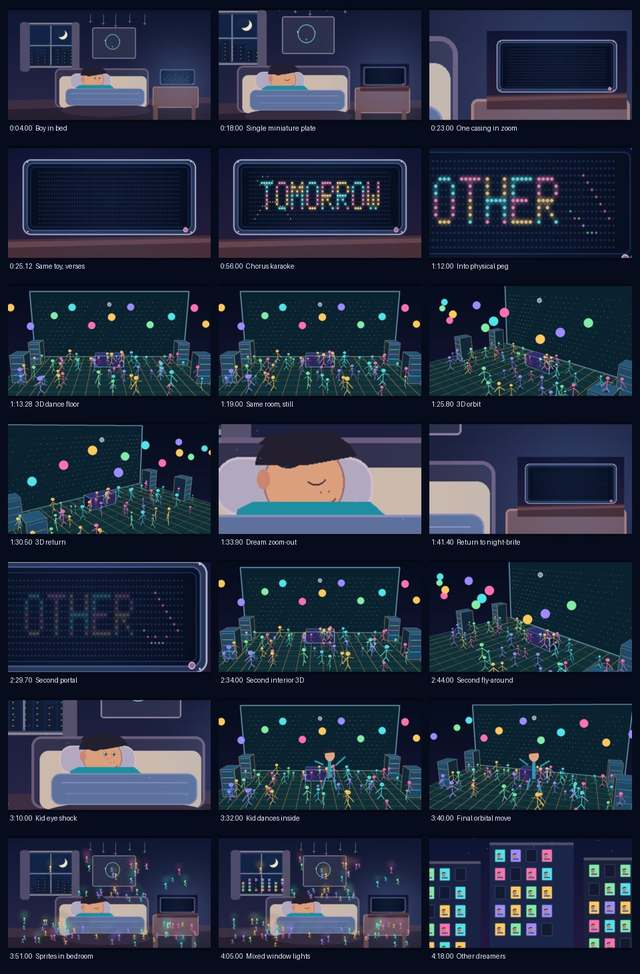

# Nobody Owns Tomorrow — The Other Side 🎬🎶

**A miniature disco inside a glowing Night-Brite.** A boy falls asleep while the tiny characters begin dancing through the dream, the bedroom, and finally a whole city of other dreaming children.

## Latest production: V6

We have rendered a 4:23 music video with the original song and synchronized on-toy karaoke. V6 includes 3D-perspective camera orbits around flat dancers, world-anchored sprites, organic neighboring window lighting, continuity repairs, and the intentionally surprising eye-opening on the final chorus downbeat. **This is a cinematic 2.5D animatic, not photorealistic video.**

- [**V6 production source, scene cues and reproduction notes**](production/music_video_v6/README.md)
- [**Storyboard**](production/music_video_v6/storyboard_v6_web.jpg)
- [**Artist-selected source-interview timestamps**](production/music_video_v6/Nobody_V6_Deep_Links.csv)
- [**YouTube description draft**](production/music_video_v6/YOUTUBE_PASTE_DESCRIPTION.txt)
- [**Suno word timing**](production/music_video_v6/nobody_suno_word_alignment.json) — model-generated, not independently ear-verified.

**Watch the V6 music video:** The *complete* H.264/AAC master and compact encodes are stored as verified binary chunks in [output/v6-media](output/v6-media/README.md). Run `python output/v6-media/reassemble.py` after cloning, or download the assembled GitHub Actions artifact. The separate original WAV is not tracked. A YouTube link is coming after the creator publishes. Do not confuse the [early silent scene-flips preview](output/scene-flips-preview.mp4) with V6.

## Original song and inspiration

- **Original music:** [Nobody Owns Tomorrow — Suno recording](https://suno.com/song/cf3d6b12-d528-4193-a8f0-7f4e9b997ea3), clip `cf3d6b12-d528-4193-a8f0-7f4e9b997ea3`, created 2026-11-01. The published Suno URL is a **song source**, not a substitute for our completed music video.
- **Original conversation:** [The Beyond Tomorrow Podcast](https://www.youtube.com/watch?v=NXITvkHIV9o). Interview concepts and timestamps were connected by the creators as artistic interpretations, not attributed as quotations or endorsements.
- **Media and tool provenance:** [V6 release provenance](production/music_video_v6/RELEASE_PROVENANCE.md) and [execution environment snapshot](production/music_video_v6/TOOLCHAIN_EXECUTION.json).
- **Status:** V6 cut preserved in the repository; release rights and public YouTube URL not yet verified or supplied.

## A musical response, with receipts

Inspired by [**The Beyond Tomorrow Podcast — AI Experts Reveal: It’s Too Late!**](https://www.youtube.com/watch?v=NXITvkHIV9o) (2026-10-30). The song is an independent creative interpretation exploring agency, uncertainty, and shared futures, not a quotation, a speaker endorsement, or a summary of all panel views. Source deep links are preserved in the V6 folder and in the planned YouTube description.

## Artilect: all glory upstream

This is a creative production, not a new media platform. The **actual executed** toolchain for the current V6 rendering is Suno's word-timing analysis (connected integration, data included), **Pillow**, **NumPy**, and **FFmpeg**. The existing original pinned direct submodules remain unchanged: [Pillow](https://github.com/python-pillow/Pillow) (MIT-CMU), [FFmpeg](https://github.com/FFmpeg/FFmpeg) (LGPL/GPL depending on build), [ELYSY](https://github.com/gabrielxcom/elysy) (MIT; prior proposed alignment route, **not executed in V6**), [UseSuno MV Studio](https://github.com/UseSuno/UseSunoMVStudio) (AGPL-3.0-only; prior proposed karaoke route, **not executed in V6**). The current rendered V6 visual-lyric track is **custom Pillow code**, not an upstream MV Studio export. See [production notes](production/music_video_v6/README.md).

Past prototype recipe and CI validator remain in `production/`, `scripts/`, and `output/`. The V6 MP4 is preserved as byte-exact chunks in this public repository (including the musical soundtrack), but has **not been published on YouTube**. The `artilect.json` media path still points to the **early silent prototype** until a verified public V6 video URL can replace it; passing the structure validator is not the same as having a finished showcase link. Source audio rights, Suno subscription entitlement, and YouTube AI-use disclosure are subject to the creator's approval.

**Nobody owns tomorrow. Nobody owns the sky.**
