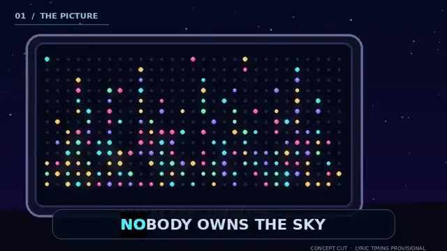

# Nobody Owns Tomorrow — The Other Side

**There's a whole party on the other side of the lightboard.** 🎶✨

[**Watch the front → rave → front scene test (silent)**](output/scene-flips-preview.mp4) · [Front](output/front.webp) · [Reverse: the rave](output/back.webp)

The song starts with a lonely, glowing pegboard city. On *“on the other side,”* we travel through a peg to a jubilant miniature rave. **When the next verse begins, we return to the front.** This repeats: front for the vocal storytelling, behind the board for each *other side* refrain and instrumental dance break. The final shot comes back to one isolated light. The planned karaoke is layered later with upstream tools, not faked with estimated word timing.

This is for [**Artilect**](https://github.com/PaulTiffany/artilect): bring the subs, drop the stack, pass the mic, all glory upstream. **Nobody is a production recipe and an art project, not a new karaoke app.**

## The upstream cypher

| Original upstream project | Original creators / license | Actual role and status |
|---|---|---|
| [Pillow](https://github.com/python-pillow/Pillow) | Jeffrey A. Clark, Fredrik Lundh, PIL/Secret Labs AB, contributors / MIT-CMU | **Used** to render front, reverse, transition, moving backgrounds |
| [FFmpeg](https://github.com/FFmpeg/FFmpeg) | FFmpeg contributors / LGPL-2.1+ default; some distributions GPL-enabled | **Used** to encode actual prototype media |
| [ELYSY](https://github.com/gabrielxcom/elysy) | Gabriel X / Eliz's LRC Generator contributors / MIT | **Selected, not yet executed**: Demucs + WhisperX vocal alignment → reviewed word-level Enhanced LRC |
| [UseSuno MV Studio](https://github.com/UseSuno/UseSunoMVStudio) | UseSuno contributors / AGPL-3.0-only | **Selected, not yet executed**: animated karaoke, custom video backgrounds, final export |

All four are **direct Git submodules** under `technologies/`, pinned to exact original upstream commits (not forks or copied vendor trees). `git submodule update --init --recursive` retrieves the source, but does not install models, binaries or dependencies. Source-compatibility of ELYSY Enhanced LRC with MV Studio's parser has been inspected; the actual handoff still needs an end-to-end test.

## Make / remix the film

Read [**production/README.md**](production/README.md) for the actual production steps. Briefly: align the real WAV and written lyrics in **ELYSY**; review them by ear; export Enhanced LRC; import LRC, sound, and our silent parallax video into **UseSuno MV Studio**; style and export the karaoke film. **The written lyrics are available** in [`production/lyrics/Nobody-Owns-Tomorrow.txt`](production/lyrics/Nobody-Owns-Tomorrow.txt).

The visuals are reproducible with the time-indexed Pillow artwork in `production/film.py` and the **six reversible pegboard crossings in `production/scene_cues.json`**. Run `bash production/render_storyboard.sh /path/to/song.wav` to reproduce the current full-length visual cut; karaoke stays off and will be supplied by ELYSY + MV Studio. The marked crossing times are creator-directed storyboard estimates, **not verified vocal alignment**. The rejected earlier hand-made lyric timer and its unreliable timestamps are not part of this new upstream-first pathway.

## Finished vs unfinished

- **Made and verified:** an actual 4:23 audio-backed visual draft, a separate 4:23 silent background for MV Studio, a short public *front → back → front* scene test, plus the original art and source recipe. The full soundtrack cut is local/private, not in public Git.
- **Not yet claimed:** accurate vocal timing, a real ELYSY alignment receipt, a UseSuno MV Studio export, or a completed Artilect showcase submission. No fabricated “karaoke passing” receipt.
- **Rights:** Suno recording provided privately by the song's creator. Recording and large full film intentionally excluded from Git; verify distribution rights before publishing audio. Original visual artwork is ours; the toy imagery is not an official Lite-Brite collaboration.

## Artilect

When the **finished** movie has been reviewed and media permissions checked, run `python scripts/validate.py` and [drop the production repo](https://github.com/PaulTiffany/artilect/issues/new?template=stack.yml). Each upstream project retains its license. Creative choices, publishing and attribution belong to the producer.

**Nobody owns tomorrow. Nobody owns the sky.**
